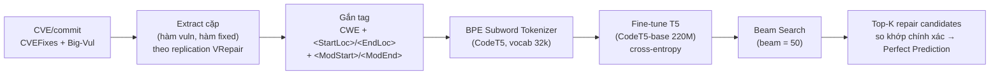

# NT521 Research — Đồ án cuối kỳ CK57: VulRepair

> Tài liệu research tổng hợp cho đồ án **NT521.R11.ANTN — Lập trình an toàn và khai thác lỗ hổng phần mềm**, HK1 2026–2027.
> **Phạm vi:** Phần A — CK57 VulRepair.
> Ngày research: **2026-10-24**. Mọi con số đều trích từ nguồn gốc (paper PDF, GitHub, Zenodo, Hugging Face, NVD). Suy luận của người tổng hợp được đánh dấu `[INFERENCE]`.

---

# Phần A — Đồ án cuối kỳ CK57: VulRepair

## A0. Thông tin thư mục & nguồn gốc

| Trường | Giá trị |
|---|---|
| Tiêu đề | VulRepair: A T5-Based Automated Software Vulnerability Repair |
| Tác giả | Michael Fu, Chakkrit Tantithamthavorn, Trung Le, Van Nguyen (Monash / Adelaide), Dinh Phung |
| Venue | ESEC/FSE '22 (30th ACM Joint European Software Engineering Conference and Symposium on the Foundations of Software Engineering), Singapore, 14–18/11/2022 |
| DOI | https://doi.org/10.1145/3540250.3549098 (13 trang) |
| Bản PDF author copy (free) | https://michaelfu1998-create.github.io/papers/vulrepair.pdf |
| PDF trong workspace | `docs/3540250.3549098.pdf` (đã đọc toàn bộ) |
| GitHub chính thức | https://github.com/awsm-research/VulRepair — MIT License, 85 stars, 18 forks, commit cuối 2025-05-13 |
| Zenodo artifact | https://doi.org/10.5281/zenodo.7080271 (v1.0, 2022-09-14; bản chụp release v1.0 của repo) |
| Checkpoint chính thức | Hugging Face: https://huggingface.co/MickyMike/VulRepair |
| Dataset HF | https://huggingface.co/datasets/MickyMike/cvefixes_bigvul |

Citation (trích nguyên văn từ README repo):

```bibtex
@inproceedings{fu2022vulrepair,
  title={VulRepair: A T5-based Automated Software Vulnerability Repair},
  author={Fu, Michael and Tantithamthavorn, Chakkrit and Le, Trung and Nguyen, Van and Dinh, Phung},
  journal={To appear in the ACM Joint European Software Engineering Conference and Symposium on the Foundations of Software Engineering (ESEC/FSE)},
  year={2022}
}
```

---

## A1. Problem & motivation

### AVR khác APR chỗ nào

- **Automated Program Repair (APR):** sửa lỗi phần mềm nói chung. Các hệ APR dựa NMT kinh điển: SequenceR (RNN, IEEE TSE 2019), CURE (GPT, ICSE 2021), CoCoNuT (CNN, ISSTA 2020), DLFix (tree-RNN, ICSE 2020), AutoTransform (Transformer+BPE, ICSE 2022). Mục tiêu của APR: tạo patch **qua được test suite** (plausible patch).
- **Automated Vulnerability Repair (AVR):** sửa lỗ hổng bảo mật. VulRepair định nghĩa AVR như bài toán **NMT**: học ánh xạ `hàm chứa lỗ hổng X_i → bản vá (repair) Y_i`, tối ưu xác suất có điều kiện `p(Y_i | X_i) = ∏ p(y_i | H, y_1..y_{i-1})` với Encoder-Decoder (Section 2 paper). Điểm khác biệt chính so với APR: AVR đánh giá bằng **khớp chính xác với bản vá do con người viết (Perfect Prediction)**, không phải pass test — vì dataset lỗ hổng (CVEFixes, Big-Vul) **không có test case**.
- Theo Chen et al., VRepair (IEEE TSE 2022) là hệ AVR NMT đầu tiên; VulRepair tuyên bố là hệ đầu tiên dùng **kiến trúc T5 + BPE + pretrain trên kho code lớn** cho AVR (Section 7 paper).

### Vì sao sửa lỗ hổng khó hơn sửa bug thường

1. **Dữ liệu thưa:** cặp (hàm lỗi, bản vá) ít hơn nhiều so với bug-fix thông thường; toàn bộ dataset của VulRepair chỉ 8,482 cặp, trong khi kho bug-fix của VRepair có hàng trăm nghìn cặp.
2. **Nhạy cảm bảo mật:** patch "trông đúng" nhưng không đóng được lỗ hổng thì vô giá trị; cần đúng ngữ nghĩa, không chỉ compile hay đẹp.
3. **Không có oracle:** không có test suite sẵn để xác nhận patch đúng ngữ nghĩa; paper tự thừa nhận (Threats to Validity, trích Liu et al. JSS 2021): đánh giá chỉ bằng exact match là chưa đủ, cần thêm số patch semantically correct / plausible — nhưng dataset không có test case nên không đo được.

### 3 hạn chế của VRepair mà authors chỉ ra (Section 2)

| # | Hạn chế VRepair | Chi tiết |
|---|---|---|
| 1 | Corpus pretrain nhỏ | VRepair pretrain trên corpus bug-fix chỉ **23,607 hàm C/C++** → biểu diễn vector chưa tối ưu |
| 2 | Word-level tokenization + copy mechanism | Copy mechanism chỉ copy được token **đã xuất hiện** trong hàm lỗi; không sinh được token **mới xuất hiện lần đầu trong bản vá** (vd: thêm biến, thêm hàm kiểm tra) |
| 3 | Vanilla Transformer + absolute positional encoding | Self-attention không học tốt **vị trí tương đối** giữa các token; dễ attend nhầm (vd: attend dấu ngoặc thay vì tên biến) |

> ⚠️ **Điểm tinh tế đáng nói khi thuyết trình:** con số "23,607" mà VulRepair gán cho corpus pretrain của VRepair thực ra là **một tập con trong replication package** (21,246 train + 2,361 val). Paper gốc VRepair (arXiv:2104.08308, Section IV-A) báo cáo corpus pretrain đầy đủ là **534,848 cặp train + 10,000 cặp val** bug-fix đơn-hunk, lọc từ 728,916,054 commit Git. VulRepair đã trích dẫn sai con số này — đây là ví dụ tốt cho slide "nhược điểm / đánh giá phê phán".

---

## A2. Đóng góp của paper (liệt kê đúng claims, không thổi)

5 claims chính (Section 1, nguyên văn ý):

1. Đề xuất **VulRepair** — phương pháp sửa lỗ hổng dựa T5, khắc phục 3 hạn chế của VRepair (pretrain lớn, BPE, T5 relative position).
2. Đánh giá mở rộng so với **2 baseline cạnh tranh**: VRepair và CodeBERT.
3. Đánh giá thực nghiệm **tác động của thành phần pre-training** với AVR.
4. Đánh giá thực nghiệm **tác động của kỹ thuật tokenization** với AVR.
5. **Ablation study** đóng góp từng thành phần của VulRepair.

Con số headline: **Perfect Prediction 44%**, cao hơn VRepair **21 điểm phần trăm** và CodeBERT **13 điểm phần trăm**; tương đương +91% tương đối so với VRepair ((44−23)/23 ≈ 91%). Sửa đúng **745/1,706** lỗ hổng trong test set.

> Lưu ý trình bày: "44%" là % trên **test set gộp CVEFixes+Big-Vul**, beam width = 50, đo bằng exact match với bản vá con người. Không phải "sửa đúng 44% mọi lỗ hổng trên thế giới".

---

## A3. Phương pháp — đủ để giảng lại 15 phút

### Pipeline end-to-end



1. **Extract:** từ CVE/commit lấy cặp (hàm chứa lỗ hổng trước commit, hàm đã vá sau commit) — pipeline tái sử dụng đúng replication package của VRepair/Chen et al. (paper không mô tả lại chi tiết từng bước extract; `[INFERENCE]` chi tiết lọc single-hunk/thời gian nằm trong code VRepair, xem A4).
2. **Gắn tag đặc biệt:** input = tag CWE của mẫu + hàm lỗi, đoạn lỗi được bọc bằng `<StartLoc>`…`<EndLoc>`; output = bản vá bọc bằng `<ModStart>`…`<ModEnd>`. 4 tag này được thêm vào vocab dưới dạng extra vocab ID để tokenizer **không cắt chúng thành subword**. Tag giúp model tập trung vào vùng cần sửa. (Trong file CSV của repo, tên tag thực tế là `<S2SV_StartBug>`, `<S2SV_EndBug>`, `<S2SV_ModStart>`, `<S2SV_ModEnd>`, `<S2SV_blank>`.)
3. **Tokenize:** BPE subword với tokenizer của CodeT5 (byte-level BPE, vocab 32,000, huấn luyện trên CodeSearchNet + C/C#). Thêm `<s>`, `</s>` (BOS/EOS) và `<pad>`.
4. **Train/fine-tune:** T5 encoder–decoder; loss cross-entropy giữa chuỗi dự đoán và chuỗi ground-truth; chọn checkpoint theo loss thấp nhất trên **validation set** (không đụng test set).
5. **Generate:** beam search, dừng khi sinh `</s>`; beam width 50 để so công bằng với VRepair (cũng dùng 50).

### Vì sao T5/CodeT5 phù hợp sửa lỗ hổng

- **Text-to-text encoder–decoder:** sửa code là bài toán code→code (sinh chuỗi), khớp bản chất sinh chuỗi của T5; RQ2 cho thấy với cùng pretrain PL/NL, T5 (44%) hơn hẳn encoder-only BERT+decoder (31%) — encoder-only sinh ra để làm code→text (vd: code summarization).
- **Relative position encoding:** T5 dùng relative position bias (Shaw et al. NAACL 2018): bias `P` học theo **khoảng cách** giữa Q và K, cộng vào ma trận K và V: `Attention(Q,K,V) = softmax(Q(K+P)ᵀ/√d_k)(V+P)`. T5 chia khoảng cách thành 32 bucket logarit (khoảng cách nhỏ <8 có bucket riêng, tối đa offset 128). Khác absolute encoding (VRepair) gắn cứng vector theo vị trí tuyệt đối → khi dòng code dịch chuyển, attention vẫn "dính" đúng token theo khoảng cách tương đối.
- **Pretrain trên code thật:** CodeT5 pretrain trên 8.35 triệu hàm, 8 ngôn ngữ (Ruby, JavaScript, Go, Python, Java, PHP, C, C#) — hiểu syntax, identifier.

### Vai trò pretrain (CodeSearchNet) vs finetune

- **Pretrain:** CodeT5 được pretrain với 4 objective (Wang et al., EMNLP 2021): (1) Masked Span Prediction (mask 15% token, span 1–5); (2) Identifier Tagging (đoán token nào là identifier người dùng đặt); (3) Masked Identifier Prediction (mask mọi lần xuất hiện của cùng identifier bằng cùng sentinel → học đặt tên nhất quán); (4) Bimodal Dual Generation (NL→PL và PL→NL).
- **Finetune:** VulRepair chỉ fine-tune trên 8,482 cặp lỗ hổng; không pretrain thêm. RQ2 chứng minh pretrain là thành phần quan trọng nhất: bỏ pretrain, T5 từ 44% → 1% (RQ4).

### BPE vs word-level tokenization

| Khía cạnh | Word-level (VRepair) | BPE subword (VulRepair) |
|---|---|---|
| Cơ chế | Clang tokenizer; token hiếm → OOV | Tách token hiếm thành subword quen thuộc (vd `IsValidSize` → `IsValid`+`Size`); không bao giờ OOV |
| Vocab | Giới hạn (|V| ∈ {2k, 5k, 10k}) | 32,000 subword |
| Token mới trong patch | **Không sinh được** — copy mechanism chỉ copy từ input | **Sinh được** — tổ hợp subword tạo identifier mới |
| Kết quả (RQ3) | VRepair 23% (word+copy) | +9–14 điểm % cho mọi kiến trúc khi chuyển sang BPE |

Paper đo: 627/1,706 (37%) cặp test có token mới chỉ xuất hiện trong bản vá; VulRepair sửa đúng 37% số đó, VRepair (copy mechanism) **không thể** sửa đúng bất kỳ cặp nào trong số này. Các patch đúng có trung bình 1.59 token mới, patch sai 4.85.

### Input representation

- Không abstract/normalize code; giữ nguyên mã nguồn C.
- Input: `[CWE tag] <StartLoc> đoạn lỗi <EndLoc> [phần còn lại của hàm]`; output: `<ModStart> bản vá <ModEnd>`.
- Block size: encoder 512 token, decoder 256 token (theo lệnh trong repo). Hàm >512 token bị **cắt cụt** — đây là nguồn gốc suy giảm accuracy ở hàm dài (A5).

### Decoding

- Beam width 50 (thí nghiệm chính, để so công bằng với VRepair cũng dùng 50); paper khảo sát thêm beam = 1, 2, 3, 4, 5, 10, 50: top-1 đạt 30% (513/1,706), top-5 41%, top-50 44%. Kết thúc khi gặp `</s>`.

### Hyperparameters chính

| Tham số | Giá trị | Nguồn |
|---|---|---|
| Kiến trúc | CodeT5-base: 12 encoder + 12 decoder, hidden 768, 12 heads, ~220M params | paper Section 4.3 |
| Learning rate | 2e-5, linear decay | paper |
| Optimizer | AdamW | paper |
| Loss | Cross-entropy; chọn best model theo val loss | paper |
| Epochs / batch | 75 epochs; batch 4 (train/eval) | README repo (batch 8 trong README của M1 → OOM, Issue #4 khuyên 4) |
| Block size | encoder 512 / decoder 256 | README repo |
| max_grad_norm / seed | 1.0 / 123456 | README repo |
| Beam | 50 (chính); khảo sát 1–50 | paper |
| Hardware paper | 1× NVIDIA RTX 3090, thời gian train ~5 giờ | paper Section 4.3 |

---

## A4. Dataset & preprocessing

### Nguồn & quy mô

| Mục | Giá trị | Nguồn |
|---|---|---|
| Dataset | **CVEFixes** (Bhandari, Naseer, Moonen — PROMISE 2021, DOI 10.1145/3475960.3475985) **+ Big-Vul** (Fan et al. — MSR 2020, DOI 10.1145/3379597.3387501) | paper Section 4.2 |
| Số mẫu | **8,482** cặp (hàm vuln, bản vá) | paper |
| Dự án nguồn | 1,754 dự án OSS | paper |
| CWE | 180+ loại CWE | paper |
| Giai đoạn | 1999–2021 | paper |
| Ngôn ngữ | C (paper mô tả "a pair of vulnerable C functions"); Big-Vul gốc là C/C++ | paper |
| Granularity | **Function-level** (không repo-level, không multi-file) | paper |
| Split | **70/10/20** train/val/test → test = 1,706 hàm | paper; repo `vulrepair_main.py` tách val bằng `train_test_split(test_size=0.1238)` trên 80% còn lại |
| License | Repo + dataset HF: MIT; Big-Vul gốc: CC-BY 4.0 | GitHub/HF |

Thống kê mô tả (paper Table 1): số token hàm lỗi — Q1 138, median 280, Q3 593, trung bình 586; số token bản vá — 12/24/48/55; Cyclomatic Complexity — 3/8/19/23.

### Cách xây cặp (vuln, patch)

Paper không mô tả lại chi tiết; nó **tái sử dụng đúng pipeline của replication package VRepair** (Chen et al.): `[INFERENCE]` từ commit của CVE lấy parent commit (hàm vuln) và commit vá (hàm fixed), giữ các fix đơn-hunk ở mức function; CWE lấy từ bản ghi CVE. Trong repo, dữ liệu đã tiền xử lý sẵn ở `data/fine_tune_data/{train,val,test,whole}.csv` với 7 cột: `cwe_id, source, target, project_and_commit_id, cve_id, original_address, time`.

### Vấn đề dữ liệu đã biết

1. **Data duplication / leakage (nghiêm trọng):** Yadav & Wilson (ACSAC 2024, "R+R: Security Vulnerability Dataset Quality Is Critical", arXiv:2503.06387) chỉ ra hàm trùng lặp giữa train và test trong Big-Vul/CVEFixes; khi **deduplicate**, exact-match của VulRepair giảm từ ~44% xuống còn **~9–13%**. Chính tác giả đã thêm **"Data Duplication Alert"** vào đầu README repo (2025-05-13). Đây là điểm phải nói thẳng khi biện luận kết quả.
2. **Mô tả dataset thiếu trong paper:** Issue #4 — người dùng train lại chỉ đạt 29.5% (M1) so với 44%; tác giả thừa nhận dataset thực tế là **CVEFixes gộp Big-Vul** (8,482 mẫu), chi tiết không được ghi rõ trong paper, và yêu cầu recombine + re-split đúng 70/10/20.
3. **Limitation paper tự thừa nhận (Threats to Validity):** kết quả không khái quát ngoài CVEFixes/Big-Vul; không có test case → không đo được patch semantically correct; hyperparams không được tối ưu (kết quả là cận dưới).
4. **Hàm dài:** >512 token bị truncate bởi cửa sổ T5.
5. **CWE hiếm:** các CWE có <5 mẫu gần như không sửa được (vd CWE-639, CWE-354, CWE-522 đạt 0%).

---

## A5. Thí nghiệm cần tái hiện (xương sống tiêu chí 3 — 5đ)

### Bảng thí nghiệm chính

| ID | Câu hỏi thí nghiệm | Dataset/split | Baseline | Metric | Kết quả paper | Script GitHub | Độ khó repro | Ghi chú GPU/RAM |
|---|---|---|---|---|---|---|---|---|
| RQ1 | Accuracy của VulRepair vs baseline | CVEFixes+Big-Vul, test 1,706 hàm, beam 50 | VRepair (23%), CodeBERT (31%) | % Perfect Prediction | **VulRepair 44%**, CodeBERT 31%, VRepair 23% | M1_VulRepair_PL-NL/vulrepair_main.py (`--do_test`); VRepair từ repo ASSERT-KTH/VRepair; CodeBERT = M2 | **Thấp** (chỉ inference) | Checkpoint M1 có sẵn trên HF `MickyMike/VulRepair`; raw predictions của paper nằm sẵn ở `data/VulRepair_raw_predictions/` |
| RQ2 | Lợi ích của pretrain | test 1,706 | 3 corpora × 2 kiến trúc (T5, BERT): PL/NL, NL-only, không pretrain | %PP | T5: PL/NL **44**, NL 6, none 1; BERT: PL/NL **31**, NL 1, none ≈0 (đọc từ Fig. 3); PL/NL cải thiện **30–38 điểm %** | M1 (T5+PL/NL), M4 (T5+NL), M3 (T5 none), M2 (BERT+PL/NL), M6 (BERT+NL), M5 (BERT none) | **Trung bình–cao** (6 model, nhưng checkpoint sẵn trên Google Drive) | Checkpoint M2–M10 trên Google Drive (link trong README từng folder) |
| RQ3 | Lợi ích của BPE | test 1,706 | 2 tokenizer × 3 kiến trúc | %PP | BPE cải thiện **9–14 điểm %**: VulRepair 44 vs 35; VRepair 34 vs 23; CodeBERT 31 vs 17 | M1 vs M7 (word); M8 (BPE+vanilla transformer); M2 vs M9 (word); VRepair gốc (word+copy) | **Trung bình–cao** | M8 cần cài fork transformers riêng (`M8_VRepair_subword/transformers`) và phải gỡ trước khi chạy model khác |
| RQ4 | Ablation đóng góp từng thành phần | test 1,706 | 4 biến thể T5 | %PP | Pre+BPE+T5 **44**; Pre+Word+T5 35; NoPre+BPE+T5 30; NoPre+Word+T5 **1** → pretrain đóng góp 14 điểm %, BPE 9 điểm % | M1, M7, M3, M10 | **Trung bình** | — |
| D1 | CWE nào sửa được | test 1,706 theo nhãn CWE | — | %PP theo CWE | Top-10 CWE nguy hiểm: **38% tổng** (171/449); CWE-416 53% (29/55), CWE-20 45% (68/152), CWE-125 32% (54/170), CWE-787 30% (16/53), CWE-78 33% (1/3), CWE-89 20% (1/5), CWE-22 25% (2/8), CWE-79 0%, CWE-352 0%; 100%: CWE-755, 706, 326, 667, 369, 77, 388, 436, 191; 0%: CWE-639, 354, 522 (hiếm, <5 mẫu) | Phân tích từ CSV raw predictions (`rq1_cve_fixes_raw_preds.csv`) + `cwe_id` | **Thấp** (chỉ lọc CSV) | Không cần GPU |
| D2 | Độ dài hàm / độ dài patch ảnh hưởng thế nào | test 1,706 | — | %PP theo bucket độ dài | Hàm ≤500 token: 64–77%; >500: **32%** (truncate 512); patch ≤10 token: 63–77%; >10: <60% | Phân tích CSV + `descriptive_stat.py` | **Thấp** | — |
| D3 | Cyclomatic Complexity ảnh hưởng | test 1,706 (CC từ Joern, có sẵn `data/cyclomatic_complexity/`) | — | %PP theo bucket CC | CC 0–10: 53%; 11–20: 46%; 21–30: 29%; 31–40: 24%; >40: 13% | CSV + Joern annotation sẵn | **Thấp** | — |
| D4 | Beam size | test 1,706 | — | %PP theo beam | beam 1: 30% (513/1,706); 5: 41%; 50: 44% | `vulrepair_main.py --do_test --num_beams {1,2,3,4,5,10,50}` | **Thấp–trung** | Mỗi giá trị beam chạy inference lại; batch 1 để tránh OOM |
| D5 | OOV: token mới trong patch | 627/1,706 cặp có token mới | VRepair (copy) | %PP trên subset OOV | VulRepair sửa đúng 37% subset OOV; VRepair: 0% | Phân tích CSV (diff token input/output) | **Thấp** | — |

*Chú thích:* %PP tính bằng (số hàm khớp chính xác trong top-K beam) / 1,706. "Độ khó" giả định 1 GPU ≥8 GB VRAM và checkpoint tải về; xem A6.

### Phân tích qualitative

Paper **không có** phân tích qualitative/manual từng ví dụ sửa đúng/sai (không có bảng case study patch). Phân tích định tính duy nhất là breakdown theo CWE (D1), độ dài (D2), độ phức tạp (D3) và beam (D4). → Đây là **khoảng trống nhóm có thể lấp** để ăn điểm cộng (xem A8): tự chạy inference trên 3–5 hàm và phân tích patch đúng/sai bằng tay.

---

## A6. Reproduction engineering

### Môi trường (pinned, trích `requirements.txt`)

| Gói | Phiên bản |
|---|---|
| transformers | 4.19.1 |
| torch | 1.10.2+cu113 |
| tokenizers | 0.11.6 |
| datasets | 2.0.0 |
| numpy / pandas / scikit-learn | 1.22.3 / 1.4.1 / 1.1.2 |
| tqdm / tensorboard / gdown | 4.62.3 / 2.8.0 / 4.5.1 |
| Python | **3.9.7** (khuyến nghị chính thức trong README/INSTALL.md) |

Lưu ý: stack này khá cũ (transformers 4.19, torch 1.10 + CUDA 11.3) — trên GPU mới (driver/CUDA 12.x) nên chạy trong **Docker/venv với CUDA 11.x** hoặc dùng GPU thế hệ cũ; `[INFERENCE]` nếu chỉ chạy inference CPU cũng khả thi (model 220M params, fp32 ≈ 880 MB weights) nhưng beam 50 trên 1,706 hàm sẽ rất chậm.

### Checkpoint

- **M1 (VulRepair): có sẵn** trên HF: `MickyMike/VulRepair` → **repro inference + eval không cần train**.
- **M2–M10 (baseline/ablation): có sẵn** trên Google Drive (folder `1jFtnmUCKFQkBKamL9YWIwxXGCb1kSRJ5`; link từng model trong README mỗi folder).
- **Zenodo 7080271:** chỉ chứa code + CSV (train/val/test/whole + raw predictions + train.log 19.5 MB), **không chứa weights**.

### Lệnh chuẩn (trích README repo)

**Inference + eval trên checkpoint chính thức (đường tối thiểu):**

```bash
cd M1_VulRepair_PL-NL
python vulrepair_main.py \
  --output_dir=./saved_models --model_name=model.bin \
  --tokenizer_name=MickyMike/VulRepair --model_name_or_path=MickyMike/VulRepair \
  --do_test --encoder_block_size 512 --decoder_block_size 256 \
  --num_beams=50 --eval_batch_size 1
```

**Train lại từ đầu (đường đầy đủ):**

```bash
python vulrepair_main.py \
  --model_name=model.bin --output_dir=./saved_models \
  --tokenizer_name=Salesforce/codet5-base --model_name_or_path=Salesforce/codet5-base \
  --do_train --epochs 75 --encoder_block_size 512 --decoder_block_size 256 \
  --train_batch_size 4 --eval_batch_size 4 --learning_rate 2e-5 \
  --max_grad_norm 1.0 --evaluate_during_training --seed 123456 2>&1 | tee train.log
```

### Dataset

- HF: `datasets.load_dataset("MickyMike/cvefixes_bigvul")` (split `train` = 80%, tự tách val 12.38% trong script; split `test` = 20%).
- Hoặc dùng CSV trong repo `data/fine_tune_data/` (whole 29.7 MB / train 21.1 MB / val 2.8 MB / test 5.8 MB).

### Hardware

- Paper: **RTX 3090, ~5 giờ train** (M1).
- Repo README: tối thiểu **8 GB VRAM**, batch giảm xuống 4 nếu OOM (Issue #4).
- Repro tối thiểu (inference+eval): không cần train; chạy được trên 1 GPU trung bình hoặc thuê Colab/Kaggle.

### Rủi ro & phương án

| Rủi ro | Mức | Đối phó |
|---|---|---|
| Train lại không ra 44% | Cao (đã xảy ra, Issue #4: 29.5%) | Không train lại nếu không cần; nếu train: dùng đúng dataset HF (8,482), split 70/10/20 đúng seed, batch 4, 75 epochs; chấp nhận báo cáo "lệch số + nguyên nhân" |
| OOM | Trung bình | batch 4 (hoặc 2), `eval_batch_size 1` |
| Checkpoint M2–M10 trên Google Drive hỏng/xóa | Thấp–trung | Kiểm tra ngay đầu tuần; fallback: chỉ dùng M1 + bảng raw predictions sẵn trong repo |
| Link hỏng trong README | Thấp | Nhiều link trỏ về repo cá nhân `MichaelFu1998-create/VulRepair`; dùng repo chính thức `awsm-research/VulRepair` |
| M8 xung đột thư viện | Trung bình | Cài fork transformers của M8 trong venv riêng; hoặc bỏ qua M8, chỉ báo cáo số paper |
| Cảnh báo data duplication | — | Trình bày như limitation (bắt buộc để GV đánh giá cao tính phản biện) |

### Phương án repro

- **Tối thiểu (bắt buộc, M2 milestone):** tải checkpoint `MickyMike/VulRepair`, chạy `--do_test` trên test set HF với beam 50 → kỳ vọng ≈44% PP (raw predictions của paper có sẵn để diff đối chiếu); chạy thêm beam 1/5/10 để tái hiện Fig. 8; sinh 3–5 ví dụ patch để demo.
- **Đầy đủ (M3):** train lại M1 75 epochs + ít nhất 2 baseline (M2 CodeBERT, M3 T5-no-pretrain) để tái hiện RQ1/RQ2/RQ4; đối chiếu từng số lệch bao nhiêu và giải thích (seed, split, phần cứng).

---

## A7. Ưu / nhược điểm (tiêu chí 3 bắt buộc biện luận)

### Ưu điểm

1. **Accuracy vượt trội so với SOTA thời điểm đó:** 44% vs 23% (VRepair) / 31% (CodeBERT) trên cùng test set, cùng beam 50.
2. **Xử lý OOV triệt để:** BPE sinh được identifier mới (37% subset OOV sửa được vs 0% của copy mechanism).
3. **Pretrain chứng minh định lượng:** +30–38 điểm % từ pretrain PL/NL — bằng chứng transfer learning hiệu quả với dữ liệu thưa.
4. **Artifact mở, đầy đủ:** MIT, có weights (HF + Drive), dataset, raw predictions, train.log, slides (`VulRepair-slide.pdf`), paper PDF — đủ điều kiện tái hiện theo đúng rubic "bài báo có mã nguồn công khai".
5. **Ablation nghiêm túc:** tách được đóng góp riêng của pretrain (14pp) và BPE (9pp).

### Nhược điểm (kèm nguồn)

1. **Exact match ≠ patch an toàn:** không compile, không chạy test, không kiểm tra patch còn giữ lỗ hổng hay không; 56% patch sai chưa được phân tích vì sao sai. (Paper tự thừa nhận, Threats to Validity; Liu et al. JSS 2021 phê bình chỉ đo perfect match.)
2. **Function-level:** không xử lý fix liên-file/multi-hunk; nhiều CVE thật cần sửa nhiều file.
3. **Cửa sổ 512 token:** hàm >500 token chỉ đạt 32% (truncate).
4. **Chỉ C/C++:** không tổng quát cho Python/Java/etc.
5. **Data leakage:** dedup → còn ~9–13% (Yadav & Wilson, ACSAC 2024; cảnh báo do chính tác giả ghi trên README repo).
6. **Trích dẫn nhầm corpus VRepair:** gọi 23,607 là "toàn bộ corpus pretrain" trong khi bản gốc là 534,848 cặp (xem A1).
7. **Beam 50 bất tiện thực dụng:** analyst phải xem 50 ứng viên; top-1 chỉ 30%.
8. **Nhạy seed/split khi train lại:** Issue #4 ghi nhận 44% → 29.5% khi split khác; tính ổn định của kết quả yếu.
9. **Lỗi thời so với LLM 2024–2026:** các hệ repair hiện đại dùng LLM lớn + agent + validation bằng thực thi (execution-based) trên dataset đã dedup; NMT 220M params không cạnh tranh về chất lượng patch dài/đa file — nhưng VulRepair vẫn là baseline chuẩn trong AVR và là bài học kiến trúc tốt (điểm này để trả lời câu hỏi "tại sao học paper cũ").

---

## A8. Ý tưởng điểm cộng (tiêu chí 4 — 1đ)

3 phương án, xếp hạng theo effort/phần cứng/rủi ro:

### PA-1 (Recommended): Eval trên dữ liệu/kịch bản mới + case study CWE cụ thể

- **Làm gì:** (a) case study: tự xây 3–5 hàm C chứa lỗ hổng kiểu toy (tự host, không nhắm hệ thống thật — vd CWE-787 out-of-bounds write, CWE-416 use-after-free), cho VulRepair sinh patch, phân tích tay từng patch đúng/sai, tổng kết pattern; (b) chạy eval trên subset test theo CWE cụ thể (vd toàn bộ CWE-787/CWE-416 trong test set CVEFixes) và báo %PP riêng — dữ liệu có sẵn trong CSV (`cwe_id`), chỉ cần lọc + inference.
- **Vì sao được công nhận "kịch bản/dữ liệu mới":** case study trên hàm ngoài dataset gốc + phân tích mức CWE chưa có trong paper (paper chỉ gộp Top-10).
- **Effort:** thấp–trung (2–3 buổi); **Hardware:** 1 GPU ≥4 GB VRAM (inference) hoặc CPU; **Rủi ro:** thấp (không train). **Cách đo:** bảng %PP theo CWE + bảng case study "vuln → patch → đúng/sai → lý do".

### PA-2 (Fallback nếu hết GPU): So sánh 0-shot LLM vs VulRepair trên cùng test set nhỏ

- **Làm gì:** lấy 20–50 hàm từ test set, prompt GPT/Claude/CodeLlama (API) "sửa lỗ hổng, trả nguyên hàm", đo exact match + phân tích chất lượng (compile? có thật sửa lỗi?).
- **Effort:** thấp; không cần GPU (API). **Rủi ro:** chi phí API nhỏ; kết quả phụ thuộc model — nhưng đây chính là "kịch bản mới" hợp lệ. **Cách đo:** bảng VulRepair vs LLM (exact match, compile rate, số patch đúng ngữ nghĩa).

### PA-3 (Mạnh nhưng nặng): Oracle compile + dedup/time-split

- **Làm gì:** thêm oracle: compile các patch sinh ra trên subset (đo % plausible patch — lấp đúng lỗ hổng paper tự thừa nhận); hoặc tái eval với dedup (theo Yadav & Wilson) / split theo thời gian.
- **Effort:** cao (cần viết harness compile, hoặc download nhiều repo); **Hardware:** GPU nếu train lại (không bắt buộc — có thể eval trên checkpoint sẵn với split mới). **Rủi ro:** trung bình. **Cách đo:** % patch compile được; %PP trước/sau dedup.

**Khuyến nghị:** làm PA-1 trước (an toàn, chắc ăn điểm cộng), PA-2 nếu thời gian dư, PA-3 chỉ khi nhóm có GPU mạnh + 1 tuần rảnh.

---

## A9. Kịch bản demo 15 phút (storyboard phút-từng-phút)

| Phút | Nội dung | Người/đạo cụ |
|---|---|---|
| 0–1 | Đặt vấn đề: NVD tăng từ ~4k (2011) lên 20k+ (2021) CVE/năm; analyst tốn công sửa tay → cần AVR | Slide problem + con số |
| 1–3 | Đóng góp: VulRepair = T5 + BPE + pretrain; 44% PP vs 23%/31%; 745/1,706 | Slide contribution |
| 3–8 | Phương pháp: **1 diagram** pipeline (A3); giải 3 hạn chế VRepair; điểm nhấn BPE & relative position & RQ2/RQ4 (pretrain quyết định) | 1 slide diagram + 2 slide kết quả |
| 8–13 | Demo: (a) bảng kết quả eval tái hiện (44% vs paper, chỉ chỗ lệch); (b) **live inference** 1–2 hàm lỗi → sinh 50 ứng viên → chọn top-1, chiếu diff vuln/patch (quay video sẵn 2 phút nếu live fail) | Terminal + slide diff |
| 13–15 | Ưu/nhược (exact match, data leakage, 512 token, không test oracle) + điểm cộng đã làm (PA-1) | Slide nhược điểm + bảng điểm cộng |
| Q&A | Đáp án chuẩn bị ở A10 | — |

**Phương án dự phòng:** video 3 phút quay sẵn (inference + eval chạy trên máy nhóm, cắt cảnh terminal); mọi bảng kết quả xuất ra slide; máy demo là máy đã cài sẵn venv + checkpoint trong Docker — không phụ thuộc mạng trường.

---

## A10. Câu hỏi GV có thể hỏi (15 câu + trả lời ngắn)

1. **Perfect Prediction là gì, đo thế nào?** — % hàm mà ít nhất 1 trong top-K ứng viên beam search khớp **chính xác** bản vá con người viết; K=50 trong thí nghiệm chính (paper Section 5).
2. **Tại sao dùng T5/CodeT5 mà không CodeBERT?** — Code→Code cần sinh chuỗi; cùng pretrain PL/NL thì T5 44% vs BERT 31%; encoder-only hợp code→text hơn (RQ2).
3. **VRepair thua ở đâu?** — Word-level + copy mechanism không sinh được token mới (37% test set có token mới trong patch); corpus pretrain nhỏ; absolute position yếu.
4. **BPE xử lý OOV thế nào?** — Tách token hiếm thành subword quen thuộc; mọi chuỗi đều tokenize được; tổ hợp subword sinh identifier mới. Cải thiện 9–14 điểm % (RQ3).
5. **Pretrain corpus là gì, bao nhiêu?** — CodeSearchNet + C/C#: 8.35M hàm, 8 ngôn ngữ (paper Section 3.1).
6. **Vì sao bỏ pretrain thì chỉ còn 1%?** — Dữ liệu lỗ hổng quá ít (8,482 cặp) không đủ học ngữ pháp code từ đầu; pretrain đóng góp 14 điểm % trong ablation (RQ4).
7. **Beam width 50 có ý nghĩa gì, top-1 là bao nhiêu?** — 50 ứng viên để so công bằng với VRepair; top-1 đạt 30%, top-5 41%; beam cao đánh đổi công sức analyst.
8. **Dataset xây thế nào? Split?** — CVEFixes + Big-Vul = 8,482 cặp hàm C, 1,754 dự án, 180+ CWE, 1999–2021; split 70/10/20, test 1,706.
9. **Đã nghe nói dataset có leakage — ảnh hưởng sao?** — Có: Yadav & Wilson (ACSAC 2024) chỉ ra trùng lặp train/test; dedup xong còn ~9–13%; chính repo đã dán cảnh báo. Chúng em trình bày như limitation và có thể tái eval với dedup (điểm cộng).
10. **Model có đảm bảo patch compile/test không?** — Không; chỉ exact match. Paper tự nhận đây là threat (Liu et al. 2021); nhóm đề xuất oracle compile làm điểm cộng.
11. **Vì sao hàm >500 token kém?** — Cửa sổ T5 512 token → truncate (Discussion 6.2: 32% vs 64–77%).
12. **Vì sao CC cao thì kém?** — Hàm nhiều nhánh → nhiều đường ngữ nghĩa, sửa khó hơn; CC>20 chỉ còn 13–29% (Discussion 6.3).
13. **Input có abstract không?** — Không; giữ mã nguồn thô + tag CWE + 4 tag đặc biệt `<StartLoc>`… `<ModEnd>` để model chú ý vùng sửa.
14. **VulRepair sửa CWE nào tốt nhất?** — CWE-416 (UAF) 53%, CWE-20 (Input Validation) 45%; CWE hiếm (<5 mẫu) gần như 0% (Discussion 6.1).
15. **So với LLM hiện đại thì sao?** — LLM lớn + execution-based validation vượt trội; nhưng VulRepair là baseline AVR chuẩn, artifact mở, và là bài học về vai trò pretrain/tokenization vẫn đúng đến nay.

---

## Bibliography (Phần A)

1. Fu, M., Tantithamthavorn, C., Le, T., Nguyen, V., Phung, D. (2022). VulRepair: A T5-Based Automated Software Vulnerability Repair. *ESEC/FSE '22*. DOI 10.1145/3540250.3549098. Author copy: https://michaelfu1998-create.github.io/papers/vulrepair.pdf
2. Chen, Z., Kommrusch, S., Monperrus, M. (2022). Neural Transfer Learning for Repairing Security Vulnerabilities in C Code. *IEEE TSE*. DOI 10.1109/TSE.2022.3147265; arXiv:2104.08308; https://github.com/ASSERT-KTH/VRepair
3. Wang, Y., Wang, W., Joty, S., Hoi, S. C. H. (2021). CodeT5: Identifier-aware Unified Pre-trained Encoder-Decoder Models for Code Understanding and Generation. *EMNLP 2021*. arXiv:2109.00859; https://github.com/salesforce/CodeT5
4. Raffel, C., et al. (2020). Exploring the Limits of Transfer Learning with a Unified Text-to-Text Transformer. *JMLR 21(140)*. arXiv:1910.10683
5. Shaw, P., Uszkoreit, J., Vaswani, A. (2018). Self-Attention with Relative Position Representations. *NAACL 2018*.
6. Sennrich, R., Haddow, B., Birch, A. (2015). Neural Machine Translation of Rare Words with Subword Units. *ACL 2016*.
7. Bhandari, G., Naseer, A., Moonen, L. (2021). CVEfixes: Automated Collection of Vulnerabilities and Their Fixes from Open-Source Software. *PROMISE 2021*. DOI 10.1145/3475960.3475985
8. Fan, J., Li, Y., Wang, S., Nguyen, T. N. (2020). A C/C++ Code Vulnerability Dataset with Code Changes and CVE Summaries. *MSR 2020*. DOI 10.1145/3379597.3387501
9. Husain, H., et al. (2019). CodeSearchNet Challenge. arXiv:1909.09436
10. Feng, Z., et al. (2020). CodeBERT: A Pre-trained Model for Programming and Natural Languages. *Findings of EMNLP 2020*.
11. Chen, Z., et al. (2019). SequenceR: Sequence-to-Sequence Learning for End-to-End Program Repair. *IEEE TSE 47(9)*.
12. Liu, K., et al. (2021). A Critical Review on the Evaluation of Automated Program Repair Systems. *JSS 171*, 110817.
13. Yadav, A., Wilson, A. (2024). R+R: Security Vulnerability Dataset Quality Is Critical. *ACSAC 2024*; arXiv:2503.06387
14. VulRepair artifact: https://github.com/awsm-research/VulRepair ; https://doi.org/10.5281/zenodo.7080271 ; https://huggingface.co/MickyMike/VulRepair ; https://huggingface.co/datasets/MickyMike/cvefixes_bigvul

---

## Open questions cho nhóm (Phần A)

1. `[THIẾU]` Ngày báo cáo đồ án CK57 chính thức GV chốt (chưa có lịch → plan dùng mốc giả định, xem NT521-PLAN.md). Hỏi GVLT.
2. Nhóm có GPU nào? (RTX 3090/4090, A100, Colab Pro, Kaggle, hay không có) → quyết định phương án repro default (inference-only vs train lại).
3. Số thành viên nhóm và phân vai (plan giả định 3 role: Lead paper, Lead reproduce, Lead eval/điểm cộng).
4. Có được dùng API LLM (GPT/Claude) cho điểm cộng PA-2 không (kinh phí, chính sách lớp)?
5. Paper gốc không nêu rõ pipeline extract cặp (vuln, fix) — nhóm có cần truy ngược code VRepair để mô tả chi tiết trong slide hay chấp nhận mô tả mức paper?
